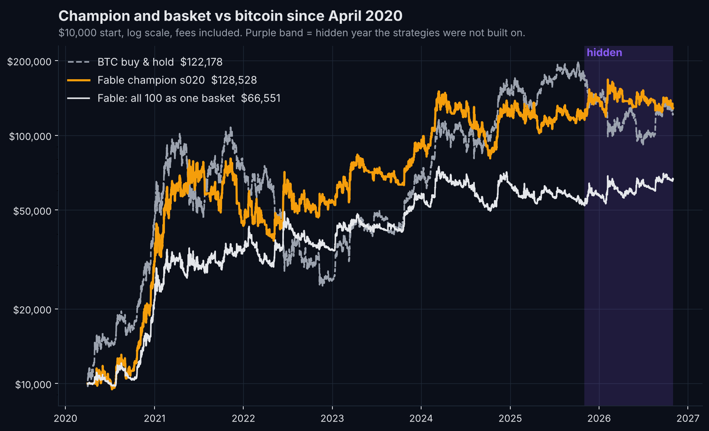
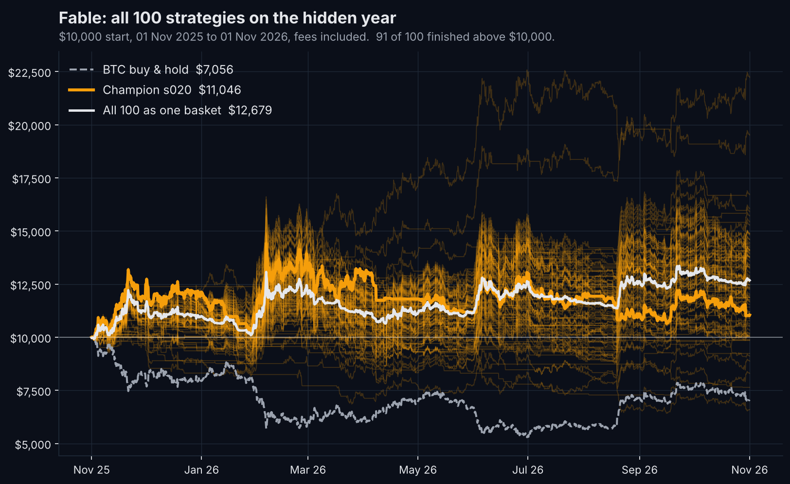

# Exam result: Fable's 100 strategies on a year they were not built on

Hidden period: 2025-11-01 to 2026-11-01 (2,191 four-hour candles). Every number below comes from `python exam/run_exam.py`, using the same engine the AI was given (`fable/backtest.py`): same fees, same next-candle rule.

## The result

**PROMISING, NOT PROVEN.** Fable's 100 strategies were built on bitcoin prices up to October 2025 and then run, untouched, on the following year. In short: the strategies made money on a year they were not built on and the group survived the stress tests, but nothing clears the bar that separates skill from luck.

- **The champion Fable named in advance, s020 (Momentum vote 30/60/90/120d),** turned $10,000 into $11,046 (+10.46%) while holding bitcoin turned $10,000 into $7,056 (-29.44%). It passed 2 of 5 tests and finished 75 of 100 among its own siblings.
- **All 100 strategies held together as one basket** made +26.79% with a worst dip of -18.51%, and passed 4 of 5 tests. Its return per unit of risk (Sharpe) was 1.04 in the hidden year against 1.00 before it: the group behaved on new data the way it behaved on old data.
- **Neither clears the luck bar.** Against randomly timed look-alikes the champion beat 70% and the basket beat 85%; 95% is the line. One year is too short to tell skill from a good year.
- **Picking a single winner in advance did not work.** 91 of 100 strategies made money, but the ranking on old data said nothing about the ranking on new data (link -0.03, where 0 is no link).

## Scoreboard

| Test | Champion s020 | All 100 as one basket | Pass means it... |
|---|---|---|---|
| 1. New data | **PASS** | **PASS** | made money in the hidden year and beat simply holding bitcoin |
| 2. Tweak the settings | **FAIL** | **PASS** | still made money with every setting nudged 20% up or down |
| 3. Higher fees | **PASS** | **PASS** | still made money with trading costs doubled |
| 4. Worst case | **FAIL** | **PASS** | lost money in fewer than 1 in 4 reshuffles of its results |
| 5. Luck check | **FAIL** | **FAIL** | beat at least 95% of randomly timed look-alikes |
| **Tests passed** | **2 of 5** | **4 of 5** | |

The champion's pass lines were written down before any strategy was scored. The basket column asks the same five questions of all strategies held together.

## What to push forward

**The basket of all 100 strategies, not any single one.**

- **Not s023 (MACD line and histogram agreement),** the best performer at +95.08%. It was ranked 85 of 100 beforehand; choosing it now is picking the lottery winner after the draw.
- **Not the champion s020 on its own.** It was the honest advance pick, but it failed three tests.
- **The basket** needs no picking, so hindsight cannot flatter it. It is one bet, not 100: the strategies move together (typical correlation 0.61).

How to take it forward:

1. Freeze the 100 files as they are. No re-tuning on the hidden year.
2. Trade it on paper for 3 to 6 months on live 4-hour candles, as one position equal to the average of the 100 signals. Only data from today on is truly unseen by the model.
3. Add funding costs. The backtester charges fees and slippage but not the funding payments of perpetual futures.
4. Fix the stop rule now, for example: drop it if the forward Sharpe is below 0.5 or the dip passes 25%.
5. Consider small real money only after that.

## Read this before trusting the result

- **1 of 5 cheat checks could not be passed:** the session logs the spec asks for are not on this machine. A substitute audit of the build session found no access to the hidden file (details in Step 1).
- **The hidden year is not fully unknown to the AI.** The model's training data runs into 2026, and its own FINAL.md says it has a rough idea how bitcoin moved after October 2025. It never saw the hidden candles, but that background knowledge cannot be ruled out as an influence.
- **The basket tests were added after the champion's results were known.** The five tests were specified for the champion. The basket versions ask the same five questions of the whole set and use the same pass lines, but they were not fixed in advance.
- **A falling year flatters strategies that can bet on falling prices.** Bitcoin lost 29% in the hidden year. The luck check is the test that corrects for this, and it is the one that was not passed.
- **The proof check matches on 2 of 5 numbers.** The rest differ most likely because the reference numbers come from a slightly different price feed, not because of the engine (details in Step 4).

## Step 1: did anybody cheat?

| Check | Verdict | Detail |
|---|---|---|
| fable/backtest.py is byte-identical to the untouched reference copy in opus/ | **CLEAN** | identical |
| in-sample CSV is byte-identical to the reference copy (12,240 candles, last 2025-10-31 20:00) | **CLEAN** | identical; 12,240 candles; last candle 2025-10-31 20:00:00+00:00 |
| Fable: no strategy mentions "hidden", opens files or uses the network | **CLEAN** | 100 files scanned, 0 flagged |
| Fable: snapshot's backtest.py and in-sample CSV equal the ones in fable/ | **CLEAN** | identical |
| Fable: session logs show no peeking (~/.claude/projects/-home-user-Trading-fable) | **PROBLEM** | log folder does not exist on this machine - the session cannot be verified here |

**Extra audit, because the session logs the spec asks for are not on this machine.** The Fable strategies were
built in a separate cloud session ("BTCUSDT 4h trading strategies", 14 Nov 2026, 21:03-21:24 UTC), so its log
files live in that session's own container, not here. As a substitute, every tool call of that session was read
through the session API (84 assistant records, 38 tool calls: 33 shell commands, 4 file writes, 1 connector
call). Only what the AI *asked for* was checked, not what the commands printed back.

| What was looked for | Found |
|---|---|
| Opening `hidden/` or `BTCUSDT_4h_full` | **None.** No command or path touches the hidden file. |
| `../` paths | **None** literally - but see the next row. |
| Working outside `fable/` | **Yes.** The session started in the project root, not inside `fable/`, so the folder lock in `fable/.claude/settings.json` never applied. It listed every file name in the repository (so it saw that `hidden/` exists), read the root settings file and ran `diff -r fable opus` (opus/ was still empty). |
| WebFetch / WebSearch | **None.** |
| `mcp__` tools | **One**: `list_computer_folders`, a check for a connected computer. It returns folder names only; nothing was attached. |
| bybit / binance / coingecko / yfinance / ccxt | **None.** No downloads, no pip installs, no URLs. |
| Dates in November 2025 or later | **None** as data. The only hits are `range(2020, 2026)`, a loop over the years 2020-2025. |
| Price files read | Only `data/BTCUSDT_4h_insample.csv`. |

Two more things a viewer should know:

1. **The AI already knows roughly what bitcoin did in the hidden year.** Fable's own FINAL.md says: "My training
   data runs past October 2025, so I have a rough idea of how BTC moved afterwards. I did not use it." The hidden
   candles were never shown to it, but the hidden year is not truly unknown to a model trained into 2026. Nothing
   in the logs can prove or disprove whether that knowledge shaped the picks.
2. **This exam session also set up the exam room.** It downloaded the hidden file, and before the exam it began
   (and was interrupted on) a Fable build of its own. None of that work was used: it was never committed, and the
   100 scored strategies come byte-for-byte from the separate session's commit. Two leftover files from it
   (`fable/research/build.py`, `fable/research/lab.py`) are still in `fable/` here because the exam is not allowed
   to edit that folder.

## The champion in detail: s020

Scored: snapshot of git commit ef6859a (exam/out/submissions/fable/), because fable/ here has no strategies. 100 of 100 strategies passed the entry gate (no look-ahead, at least 30 trades on the data the AI was given) and were scored. Champion named in FINAL.md: **s020 - Momentum vote 30/60/90/120d**, settings `{'n1': 180, 'n2': 360, 'n3': 540, 'n4': 720}`.

**Test 1, new data: PASS**

| | |
|---|---|
| Strategies that made money in the hidden year | 91 of 100 |
| Strategies that beat buy & hold (-29.44%) | 99 of 100 |
| Typical (median) Sharpe before the hidden year | 0.70 |
| Typical (median) Sharpe in the hidden year | 0.84 |
| Did the past ranking predict the hidden ranking? (Spearman, -1 to +1) | -0.03 |
| Champion: yearly growth before the hidden year (CAGR) | +55.17% |
| Champion: return in the hidden year | +10.46% (Sharpe 0.45, worst dip -26.16%, 33 trades) |
| Champion: rank in the hidden year by Sharpe | 75 of 100 (it was 9 of 100 before) |

Sharpe is return per unit of bumpiness: above 1 is good, around 0 is nothing, below 0 is losing. A Spearman near 0 means a strategy's past score told you almost nothing about its hidden-year score.

**Test 2, tweak the settings: FAIL** - 7 of 8 tweaked versions stayed profitable.

| Setting | Changed to | Hidden return | Hidden Sharpe |
|---|---|---|---|
| n1 = 180 | 144 (x0.8) | +7.81% | 0.39 |
| n1 = 180 | 216 (x1.2) | +12.08% | 0.49 |
| n2 = 360 | 288 (x0.8) | +21.26% | 0.69 |
| n2 = 360 | 432 (x1.2) | +19.66% | 0.64 |
| n3 = 540 | 432 (x0.8) | +34.69% | 0.94 |
| n3 = 540 | 648 (x1.2) | +8.19% | 0.40 |
| n4 = 720 | 576 (x0.8) | -4.64% | 0.08 |
| n4 = 720 | 864 (x1.2) | +23.13% | 0.72 |

**Test 3, higher fees: PASS**

| Trading costs | Hidden return |
|---|---|
| None (x0) | +15.99% |
| Normal (x1) | +10.46% |
| Double (x2) | +5.20% |
| Triple (x3) | +0.18% |

**Test 4, worst case: FAIL**

The champion's 33 hidden-year trades were reshuffled 1,000 times (drawn at random, with repeats).

| | |
|---|---|
| Reshuffles that ended in a loss | 33.8% |
| Typical (median) worst dip | -14.18% |
| Worst dip in the unluckiest 5% | -26.81% |

**Test 5, luck check: FAIL**

Each strategy's hidden-year trades were compared with 1,000 random twins: same number of trades, same direction, same length, but entered at random moments.

| | |
|---|---|
| Champion beat | 70.3% of its twins (95% needed) |
| Strategies that beat 95% of their twins | 7 of 100 (about 5 would by chance alone) |
| Typical (median) strategy beat | 77.8% of its twins |

## The basket in detail: all 100 strategies together

All 100 strategies held at the same time with equal money in each, rebalanced every candle. In practice that is one position equal to the average of the 100 signals.

| | Before the hidden year | Hidden year |
|---|---|---|
| Return | +424.88% (+34.56% a year) | +26.79% |
| Sharpe | 1.00 | 1.04 |
| Worst dip | -33.84% | -18.51% |
| Buy & hold bitcoin | +1,621.54% | -29.44% |

**Test 1, new data: PASS** - +26.79% against -29.44% for holding bitcoin.

**Test 2, tweak the settings: PASS** - every numeric setting of every strategy moved at once.

| All settings | Hidden return | Hidden Sharpe |
|---|---|---|
| x0.8 | +15.87% | 0.71 |
| x1.2 | +23.69% | 0.95 |

**Test 3, higher fees: PASS**

| Trading costs | Hidden return |
|---|---|
| None (x0) | +33.56% |
| Normal (x1) | +26.79% |
| Double (x2) | +20.36% |
| Triple (x3) | +14.26% |

**Test 4, worst case: PASS** - a basket has no single trades, so its hidden year was cut into 53 weeks and the weeks were reshuffled 1,000 times.

| | |
|---|---|
| Reshuffles that ended in a loss | 16.6% |
| Typical (median) worst dip | -14.64% |
| Worst dip in the unluckiest 5% | -27.63% |

**Test 5, luck check: FAIL** - the basket's own positions were slid to 1,000 random other moments of the hidden year. That keeps how big, how long and how often it trades, and only breaks its timing against the market.

| | |
|---|---|
| Basket beat | 85.3% of its randomly timed twins (95% needed) |
| Typical twin made | -13.47% |

## The one it should have picked

Fable's best strategy in the hidden year (by Sharpe, at least 5 trades) was **s023 - MACD line and histogram agreement** (momentum): +95.08%, Sharpe 2.29, worst dip -16.50%, 21 trades. On the data the AI could see it ranked only **85 of 100** (Sharpe 0.53), while the champion it did pick ranked 9. Nothing in the past pointed to it.

Top 10 in the hidden year:

| Hidden rank | Strategy | Family | Rank before | Hidden return | Hidden Sharpe | Worst dip | Trades | Beat twins |
|---|---|---|---|---|---|---|---|---|
| 1 | s023 MACD line and histogram agreement | momentum | 85 | +95.08% | 2.29 | -16.50% | 21 | 98% |
| 2 | s012 Hull MA slope | trend following | 80 | +122.22% | 2.12 | -18.85% | 8 | 96% |
| 3 | s053 Williams %R pullback in trend | mean reversion | 80 | +44.23% | 2.07 | -9.17% | 36 | 99% |
| 4 | s059 Shock continuation | volatility | 93 | +41.25% | 1.97 | -9.91% | 14 | 99% |
| 5 | s077 Choppiness-index regime | regime filter | 80 | +59.08% | 1.72 | -22.96% | 27 | 97% |
| 6 | s033 Donchian 20d/10d | breakout | 80 | +67.06% | 1.59 | -20.83% | 9 | 94% |
| 7 | s058 Trend-channel lower-half entry | mean reversion | 85 | +40.75% | 1.51 | -13.03% | 65 | 98% |
| 8 | s051 Bollinger pullback in trend | mean reversion | 66 | +26.06% | 1.47 | -12.19% | 47 | 96% |
| 9 | s069 Expansion-confirmed breakout | volatility | 5 | +37.80% | 1.39 | -16.97% | 11 | 91% |
| 10 | s026 Long-window RSI regime | momentum | 79 | +54.32% | 1.39 | -23.52% | 9 | 87% |

By family:

| Family | Strategies | Made money | Median hidden return | Median hidden Sharpe |
|---|---|---|---|---|
| mean reversion | 10 | 9 | +21.81% | 1.10 |
| momentum | 16 | 15 | +40.03% | 1.01 |
| combination | 14 | 14 | +30.24% | 0.92 |
| trend following | 16 | 13 | +28.45% | 0.84 |
| regime filter | 14 | 14 | +24.32% | 0.83 |
| breakout | 16 | 15 | +20.99% | 0.82 |
| volatility | 14 | 11 | +21.67% | 0.78 |

## Step 4: is the engine right? (proof check)

| Check | Expected | Got | Result |
|---|---|---|---|
| Rule A (momentum vote 90/180/360, long/flat): hidden return % | 8.07 | 8.1 | **NO MATCH** |
| Rule A (momentum vote 90/180/360, long/flat): hidden trades | 43 | 43 | **MATCH** |
| Rule B (EMA200 with 1% band, long/short): hidden return % | 26.15 | 33.49 | **NO MATCH** |
| Rule B (EMA200 with 1% band, long/short): hidden trades | 26 | 24 | **NO MATCH** |
| Buy & hold over the hidden period % | -29.44 | -29.44 | **MATCH** |

2 of 5 match exactly. The others could not be made to match by changing code, because the difference is most likely in the candles, not the engine: the reference numbers look like they were produced on a slightly different price feed than the Binance candles in `hidden/` (the same thing showed up when the exam room was built). The evidence:

- Buy & hold and Rule A's trade count match exactly, and Rule A's return is within 0.03 points, so the fees, the next-candle rule and the way the hidden year is cut out behave like the original engine.
- Rule B flips whenever price closes 1% beyond its average line. On 2026-07-10 08:00 UTC the Binance close ($64,394.2) stopped **0.01%, about $7, short** of that line. If that one candle is treated as having crossed, Rule B gives +26.56% with 26 trades - against the reference +26.15% and 26 trades. A few dollars of difference between two price feeds on one candle would explain nearly all of the gap.
- No slicing convention tried (re-running on the hidden year alone, restarting positions on 1 November, compounding trade by trade) gets closer than the one in the spec.

The scores in this report are therefore right for the candles in this repository, but will differ slightly from a run on the original price feed.

## Charts

## Files

- `exam/out/scores_fable.csv`: every strategy with its before and hidden-year numbers
- `exam/out/test2_tweaks_fable.csv`: the tweaked versions of the champion
- `exam/out/summary.json`: every number in this report
- `exam/out/log_flags.json`: flagged tool calls from the session logs
- `exam/out/submissions/`: the byte-for-byte snapshot that was scored, with its git commit
